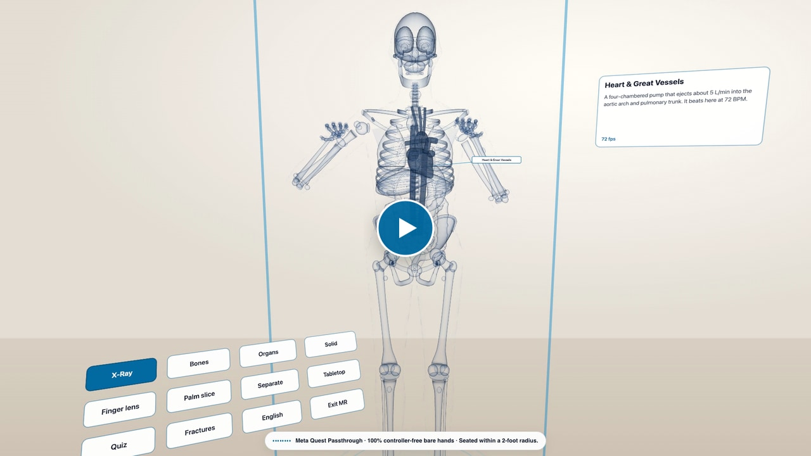
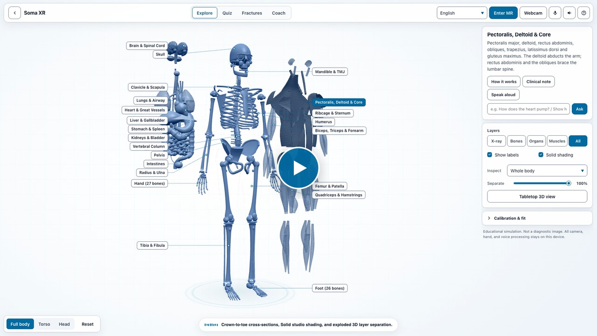

# Soma XR — Full-Body Hands-First Spatial Anatomy & Regional Coaching Studio

- **Live WebXR & 3D Studio (HTTPS):** https://taiwrash.github.io/soma-xr/
- **Watch Full Pitch & Demo (`2:40` on YouTube):** https://youtu.be/L2M2Z6523CU
- **Stream 60s Judge Sizzle Cut (`0:54` HD MP4):** https://taiwrash.github.io/soma-xr/media/Soma-XR-60s-Judge-Sizzle.mp4
- **Repository:** https://github.com/Taiwrash/soma-xr

Built with **Meta Immersive Web SDK (`@iwsdk/core` v1.1 + Three.js + WebXR `immersive-ar`)**, **MediaPipe Full-Body Pose + Face + Hand Vision**, and **Meta AI Massively Multilingual Speech (`MMS-TTS`)** for the **Meta Start Developer Competition 2026** (*Productivity Track* + *Best First Five Minutes*, *Boldest Original Concept*, *Best Agentic Interaction*, *Best Reason to Come Back*, and *Best Accessibility Forward*).

---

## Video Showcase

| Flagship Pitch & Full Demo (`2:40` · YouTube) | Fast Judge Sizzle Cut (`0:54` · Instant Stream) |
| :---: | :---: |
| [](https://youtu.be/L2M2Z6523CU) | [](https://taiwrash.github.io/soma-xr/media/Soma-XR-60s-Judge-Sizzle.mp4) |
| **[▶ Watch Full Pitch & Demo on YouTube](https://youtu.be/L2M2Z6523CU)** · [Closed Captions (`.srt`)](videos/Soma-XR-Pitch-and-Demo.srt) | **[▶ Stream 60s Judge Sizzle Cut](https://taiwrash.github.io/soma-xr/media/Soma-XR-60s-Judge-Sizzle.mp4)** · [Closed Captions (`.srt`)](videos/Soma-XR-60s-Judge-Sizzle.srt) |

---

## Core Spatial Experience Pillars

1. **Distraction-Free Startup Hero & Monochromatic Clinical Light Theme:**
   - Clean, badge-free startup landing page opening in one click into a full-body 3D anatomy studio rendered in a single unified cobalt radiograph palette (`#0369a1`) across desktop, mobile (`390px`+), webcam, and Meta Quest Passthrough AR.
2. **Life-Size 1.74 m Full-Body 3D Anatomy Rig (22 Sculpted Structures):**
   - **Axial & Appendicular Skeleton:** Cranium & facial pillars, TMJ-articulated mandible, 24-segment vertebral column + sacrum, 12-pair ribcage + sternum, S-curved clavicles & scapulae, pelvic girdle, articulated humeri + twin radius/ulna forearms, 27-bone hands, femurs & patellae, twin tibiae/fibulae, and 26-bone foot arches.
   - **Living Visceral Organs & Nervous System:** Cerebral hemispheres, cerebellum, spinal cord, **72 BPM beating heart & great vessels**, **breathing lungs & bronchial tree**, liver & gallbladder, stomach & spleen, kidneys & bladder, and small/large intestines.
   - **Full-Body Striated Musculature:** Trunk, shoulder, upper-limb, and lower-limb muscle groups with 3D exploded layer separation.
3. **100% Hands-First, Seated-Optimized Mixed Reality ("Airplane Seat Test"):**
   - **Meta Quest 3 / 3S (`immersive-ar`):** Controller-free end-to-end with 26-joint WebXR bare-hand bone overlay, full-height grounded spatial mirror, 4×3 direct-poke 3D console (`44 cm` ahead), calm **`0.30x` Tabletop Specimen** (`50 cm` ahead inside a 2-foot seated radius), true-scale **Finger X-Ray Lens** (with a `14%` radiographic context silhouette outside the ring), and **6DoF Flat-Palm CT Slicing**.
   - **Desktop Webcam & Interactive 3D Studio:** 33-point MediaPipe `PoseLandmarker`, 478-point `FaceLandmarker`, and 21-point `HandLandmarker` with instant zero-permission 3D fallback.
4. **Region-Based Native Neural Voice & Visual Coaching (14 African & Global Languages):**
   - Translates all 22 3D spatial callouts, biomechanical/clinical notes, Quiz clues, and Fracture Scan cases—paired with **authentic native tonal neural speech** and **real-time 3D TMJ jaw lip-sync**:
     - **African Languages (9):** **Yorùbá** (`facebook/mms-tts-yor`), **Hausa** (`facebook/mms-tts-hau`), **Igbo** (`Shinzmann/soro-tts-ibo`), **Kiswahili**, **isiZulu**, **Amharic (አማርኛ)**, **Naija Pidgin**, **Af-Soomaali**, and **Afrikaans** (including **405 pre-bundled offline-ready native Yorùbá, Hausa, and Igbo MP3 clips** in `public/audio/coach/`).
     - **Global Languages (5):** **English**, **Français**, **العربية (RTL)**, **Español**, and **Português**.

---

## Quick Start

Requires **Node.js >= 22.12** (`.nvmrc` included):

```bash
nvm use 22
npm install
npm run dev
```

- **Local Studio & Quest 3 Emulator:** `http://127.0.0.1:5173/`
- **Production Build & Static HTTPS Deploy for Meta Quest Browser:**
  ```bash
  npm run build
  ```

---

## Deploying to GitHub Pages (Meta IWSDK Chapter 8)

This repository is pre-configured for **GitHub Pages** with automatic subpath resolution (`vite.config.ts` auto-detects `/<repo-name>/` from `GITHUB_REPOSITORY`), `import.meta.env.BASE_URL`-safe MediaPipe WASM & pre-bundled African neural audio paths, `.nojekyll`, and `.github/workflows/deploy.yml`:

1. Build and publish the static production bundle directly to the `gh-pages` branch:
   ```bash
   npm run deploy
   ```
2. On GitHub, go to **Settings → Pages → Build and deployment**:
   - **Source:** `Deploy from a branch`
   - **Branch:** `gh-pages` / `/ (root)` → **Save**
   *(A `.github/workflows/deploy.yml` workflow is also included if deploying via GitHub Actions).*
3. Your HTTPS WebXR app is served at:
   `https://taiwrash.github.io/soma-xr/`
